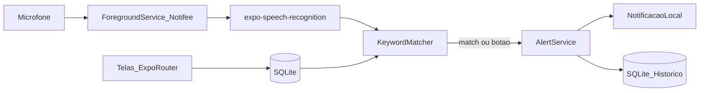

# App de Escuta com Palavras-Chave (Android + Expo)

## Escopo do MVP

- Plataforma: **somente Android**
- Stack: **React Native + Expo** (development build — **não** roda 100% no Expo Go)
- 4 telas: início, palavras-chave, contatos, histórico
- Disparo de alerta por **voz** (palavra-chave) ou **botão manual**
- Alerta inicial: **notificação local** (push local no aparelho)
- Contatos cadastrados agora; **WhatsApp em fase futura**

## Limitação importante (realista)

Escuta contínua em segundo plano no Android exige **Foreground Service** com notificação persistente (“Escuta ativa”). O `SpeechRecognizer` do Android não foi feito para “wake word” 24/7 com baixo consumo; o MVP usa **reconhecimento contínuo em loop** (reconhecer → comparar palavras → reiniciar), mantido vivo pelo foreground service.

Isso funciona bem com o app em uso ou em segundo plano com a notificação fixa. Não é equivalente a um assistente tipo “Ok Google” otimizado para bateria.

## Arquitetura



**Fluxo de alerta**
1. Usuário liga a escuta na tela inicial (pede `RECORD_AUDIO` + permissão de notificação).
2. App inicia foreground service (notificação fixa) + loop de speech recognition em `pt-BR`.
3. Texto parcial/final é normalizado (lowercase, sem acento) e comparado às palavras-chave.
4. Em match (ou toque no botão SOS): cria registro no histórico + dispara notificação local alta prioridade.
5. Contatos ficam salvos para a fase WhatsApp (telefone + nome).

## Stack concreta

| Área | Escolha |
|------|---------|
| App | Expo SDK atual + TypeScript + **expo-router** (tabs) |
| Build | `expo-dev-client` + EAS Build / `npx expo run:android` |
| STT | [`expo-speech-recognition`](https://github.com/jamsch/expo-speech-recognition) (`pt-BR`, continuous/partial results) |
| Background | [`@notifee/react-native`](https://notifee.app/) foreground service tipo `microphone` + config plugin no `app.json` |
| Dados | `expo-sqlite` (palavras, contatos, histórico) |
| Notificação de alerta | `expo-notifications` ou Notifee (canal `alerts`, importância alta / full-screen se possível) |
| Navegação | 4 tabs: Início / Palavras / Contatos / Histórico |

## Estrutura do projeto

```
TesteApp/
  app/
    (tabs)/
      index.tsx          # tela inicial + botão SOS + toggle escuta
      keywords.tsx       # CRUD palavras-chave
      contacts.tsx       # CRUD contatos
      history.tsx        # lista de alertas
  src/
    db/schema.ts         # tabelas SQLite
    services/
      listeningService.ts
      keywordMatcher.ts
      alertService.ts
    types.ts
  app.json               # permissions + plugins
```

## Modelo de dados (SQLite)

- `keywords`: `id`, `word`, `created_at`
- `contacts`: `id`, `name`, `phone` (E.164), `created_at` — prontos para WhatsApp depois
- `alerts`: `id`, `trigger` (`voice` | `manual`), `matched_word` (nullable), `created_at`, `notified` (bool)

Seed inicial opcional: `socorro`, `perigo`.

## Telas (comportamento)

1. **Início** — status da escuta (ligada/desligada), toggle, botão grande de alerta manual, última palavra ouvida (debug/feedback).
2. **Palavras-chave** — listar / adicionar / remover; validar não vazia e sem duplicata.
3. **Contatos** — nome + telefone; sem envio ainda (texto na UI: “usados em breve para WhatsApp”).
4. **Histórico** — lista cronológica dos alertas (origem voz/manual + palavra + horário).

## Config Android (obrigatória)

No [`app.json`](app.json) / config plugins:

- Permissões: `RECORD_AUDIO`, `POST_NOTIFICATIONS`, `FOREGROUND_SERVICE`, `FOREGROUND_SERVICE_MICROPHONE`
- Plugin Notifee + serviço com `foregroundServiceType="microphone"`
- Plugin `expo-speech-recognition`
- `android.package` definido; idioma STT `pt-BR`

## Fases de entrega

### Fase 1 — App base (este plano)
- Scaffold Expo + tabs + SQLite
- CRUD palavras e contatos
- Botão SOS → notificação + histórico
- Escuta com app em primeiro plano + match de keywords

### Fase 2 — Segundo plano
- Foreground service Notifee
- Manter loop de STT com app minimizado
- Tratamento de erros (reconhecimento caiu → reinicia)

### Fase 3 — Futuro (fora do MVP)
- Envio WhatsApp: `Linking` `https://wa.me/<phone>?text=...` (abre o app; usuário confirma) **ou** API WhatsApp Business (automático, precisa conta/cloud)
- Possível evolução para wake-word (Porcupine/Vosk) se bateria/precision virarem problema

## Como validar

1. `npx create-expo-app` → instalar deps → `npx expo prebuild` / `eas build --profile development --platform android`
2. Instalar APK no device físico (microfone real)
3. Cadastrar `socorro` / `perigo`, ligar escuta, falar a palavra → notificação + item no histórico
4. Testar botão SOS sem voz
5. Minimizar o app com escuta ligada → confirmar notificação “Escuta ativa” e que o match ainda dispara

## Riscos a aceitar no MVP

- Consumo de bateria maior com escuta contínua
- STT do Google no device pode exigir rede em alguns aparelhos; partial results variam por OEM
- Play Store exige declaração clara do uso do microfone em background (privacy / Data safety) se for publicar depois
